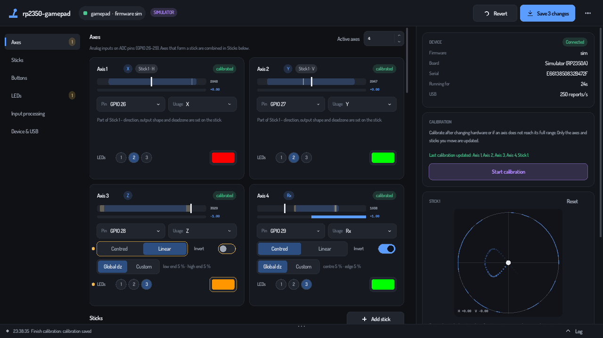
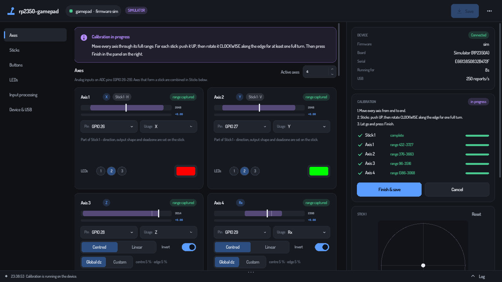

# rp2350-gamepad

Firmware and a desktop configurator for building your own USB game
controller with an **RP2350** microcontroller: thumbsticks, throttles,
buttons and RGB status LEDs. It started as a HOTAS stick extension and
works for any DIY joystick, button box or gamepad.

- **Plug and play.** The device shows up as a standard USB gamepad (or
  joystick); no drivers are needed on Windows, Linux or macOS.
- **One configurator for everything.** Set pins, axes, sticks, buttons,
  LEDs, deadzones, smoothing and USB identity in one window, and watch
  every input live.
- **Safe to experiment with.** Changes stay unsaved (marked in amber)
  until you press Save. The device checks every setting itself and
  explains what's wrong. LED colour changes are previewed live while the
  gamepad keeps working unchanged.
- **Reliable calibration.** Only the axes you actually move are updated.
  For sticks, push up and rotate clockwise once, and orientation and
  mirroring are detected automatically. A roundness meter shows how
  circular the output is.
- **Robust firmware.**
  - Settings are kept in two flash copies, so pulling the cable mid-save
    can't lose them.
  - They survive firmware updates.
  - A watchdog restarts a hung device, and repeated crashes put it into a
    safe mode.
  - The LEDs go dark when the computer sleeps.
- **Verifiable releases.** Firmware builds are reproducible, and every
  download comes with checksums and signed GitHub build provenance.

## Quick start

1. **Flash the firmware.** Download `rp2350-gamepad-<version>.uf2` from the
   [latest release](https://github.com/gethiox/rp2350-gamepad/releases/latest).
   Hold the board's **BOOT** (BOOTSEL) button while plugging it in; a drive
   called `RP2350` appears. Copy the `.uf2` file onto it. The board restarts
   as a gamepad.
2. **Get the configurator** for your system from the same release:
   - **Windows:** unzip and run `rp2350-gamepad-configurator.exe`. If
     SmartScreen warns about an unknown publisher, choose *More info →
     Run anyway*. The app is open source but not code-signed.
   - **macOS:** unzip and move the app to *Applications*. The first time,
     right-click it and choose *Open*, because it is not notarised by
     Apple.
   - **Linux:** unpack the `.tar.gz` and run `install-udev-rule.sh` once
     (see [docs/linux.md](docs/linux.md)). Then start
     `rp2350-gamepad-configurator`.
3. **Connect.** The configurator finds the device automatically.
4. **Calibrate.** Press *Start calibration*, then:
   - move every axis from end to end;
   - push each stick **up** and rotate it **clockwise** one full turn;
   - let go and press *Finish & save*.
5. **Configure** pins, colours and so on, then press **Save**. The device
   restarts in about a second and the configurator checks that everything
   was stored.

Settings are kept when you update the firmware later. Only a release that
changes the settings format resets them; its release notes will say so.

## Wiring

| What | Default pins | Notes |
|---|---|---|
| Axes (potentiometers / hall sensors) | GPIO 26, 27, 28, 29 | Only ADC pins work: GPIO 26-29 on RP2350A boards. Wire the sensor between 3V3 and GND, wiper to the pin. |
| Buttons | GPIO 14, 15, 0, 1, 2, 3, 4, 5 | Connect each button between its pin and **GND**. Internal pull-ups are used, so no resistors are needed. |
| Calibration button (optional) | none | Any GPIO. Hold 1 s to calibrate, press again to finish. Hold 10 s to factory reset (see below). |
| WS2812 / NeoPixel LEDs | GPIO 22 (the board's built-in LED), 23, 24, 25 | One LED or a chain of LEDs per pin (up to 64 LEDs in total). Power them from 5 V (VBUS) and connect the first LED's data input to the pin. |

All of these can be changed in the configurator. Any GPIO works for
buttons and LEDs. The defaults match the author's HOTAS extension.

LEDs are numbered across the LED pins in order: with a single LED on
GPIO 22 and a chain of four on GPIO 23, LED 1 is the built-in one and
LEDs 2-5 are the chain. Every axis and button picks the LEDs it lights.
An axis can light them in three ways:
- **Glow:** all of them brighten as the axis moves.
- **Bar:** a level meter. A centred axis fills outward from the middle.
- **Dot:** a point that slides along them, for example the stick's
  left/right position on a row of LEDs.

Bar and Dot run along each LED pin's chain on its own. A single selected
LED on another pin glows as a classic indicator, so one axis can drive a
4-LED bar and a separate indicator LED at the same time.

## Using the configurator

- **Amber dot or outline:** a change that is not saved yet. Hover the dot
  to see the saved value; click it to undo just that change. *Revert*
  undoes everything.
- **Red outline:** the device rejected the value. The reason is shown on
  the field, and *Save* stays disabled until it is fixed.
- **Save** writes everything at once (Ctrl+S). Inputs and USB settings
  only change after saving. LED colours and brightness are previewed live
  while you edit.
- **Live panel (right):** device status, calibration, a visualiser for
  every stick (with trail and roundness measurement), and buttons and
  LEDs.
- **Status bar (bottom):** the latest message. Click it, or drag it up,
  to open the log below it. In the log you can scroll, select text with
  the mouse (double-click selects a line) and copy it with Ctrl+C. *Copy
  all* puts the whole log on the clipboard for bug reports.
- **⋯ menu:** export/import a backup (`.json`), reset calibration, factory
  reset, settings and about. You can also drag a backup file onto the
  window to import it.
- **Settings:**
  - interface size, for small or high-resolution screens;
  - frame rate: 60 FPS by default, higher for high refresh rate
    displays;
  - the USB IDs to look for;
  - live LED preview on or off.

## Calibration

Calibration only updates what you move, so you can recalibrate a single
throttle without touching anything else.

| Input | What to do | Result |
|---|---|---|
| Axis | Move it from one end to the other | Updates its range and centre. An axis you don't move keeps its previous calibration. |
| Stick | Push **up**, then rotate **clockwise** along the edge for one full turn | Detects which axis is horizontal or vertical, the direction of each, and the shape of the gate. |

If a stick turn isn't completed, that stick is marked *not calibrated*
and uses neutral defaults. Just calibrate again. Letting the stick go back
to the centre restarts its gesture, so a false start is harmless.

The stick's *Adjust* options (swap, flip) are only needed if a stick still
moves the wrong way after calibration.

## Status LED

| Light | Meaning |
|---|---|
| Slow white glow | Running normally (brightness adjustable). |
| Blue breathing | Waiting for the computer (not enumerated yet). |
| Fast magenta breathing | Calibrating. |
| Red breathing | **Safe mode:** the device restarted repeatedly and runs with defaults. Save a configuration or factory reset. |
| All LEDs blinking red | Factory reset in 2 s. Release the button to cancel. |
| Off | The computer is asleep or off. *Stay lit while the PC sleeps* changes this. |

## Recovery

Any of these brings a device back to defaults:

- configurator: **⋯ → Factory reset…**;
- if you set up a calibration button: hold it for 10 s, until the LEDs
  blink red, and keep holding for 2 more seconds;
- copy `rp2350-gamepad-reset-settings.uf2` (from the release) to the
  BOOTSEL drive. This erases only the stored settings; the firmware stays.

You don't need to reflash the firmware.

## Troubleshooting

- **"Looking for your gamepad…" never ends**
  - Linux: install the udev rule ([docs/linux.md](docs/linux.md)).
  - If you changed the USB vendor/product ID earlier, add it under
    *Settings → Devices to look for*.
  - Try another cable; some cables only carry power.
- **A stick moves the wrong way:** calibrate it again (push *up*, rotate
  *clockwise*). If it is still wrong, use *Adjust* on the stick.
- **LEDs flicker:** turn off *Smooth dimming*.
- **Something else:** open the log (bottom bar), press *Copy* and include
  it in an [issue](https://github.com/gethiox/rp2350-gamepad/issues).

## For developers

- [docs/building.md](docs/building.md): building firmware and
  configurator, tests, the simulator.
- [docs/architecture.md](docs/architecture.md): how the firmware works
  (storage, validation, calibration, LEDs, watchdog).
- [docs/protocol.md](docs/protocol.md): the USB serial protocol and how
  to change it safely.
- [docs/verifying-releases.md](docs/verifying-releases.md): checking
  downloads and reproducing the firmware build.

## License

MIT, see [LICENSE](LICENSE). Third-party components and fonts are listed
in [THIRD_PARTY_NOTICES.md](THIRD_PARTY_NOTICES.md).
